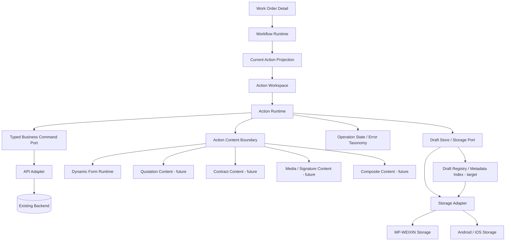

# Action Workspace Architecture

Status: G4-D UX engineering architecture  
Program: New Technician / Field Service App  
Baseline: `2ab3190e1d480612001786fbd29d5e56b6771ee2`  
Branch: `rebuild/g4d-action-workspace`

Related focused architecture:

- `docs/architecture/LOCAL_DRAFT_AND_WEAK_NETWORK_ARCHITECTURE.md` — required multi-draft, recovery, weak-network, Registry, retention and future Action Content rules.

## 1. Purpose

The Technician App is action-driven. A Work Order Detail page provides the business context, while the workflow determines what the technician should do next.

The UI architecture must therefore separate four responsibilities:

```text
Workflow Runtime
  -> Current Action
  -> Action Workspace
  -> Action Content
```

- **Workflow Runtime** answers: what action is currently available and executable?
- **Current Action** answers: what should the technician do now?
- **Action Workspace** answers: where and how is the action executed?
- **Action Content** answers: what business-specific editor/component is required to complete the action?

This architecture is the shared foundation for Appointment and later actions
such as Inspection, Quotation, Contract, Construction and Acceptance, so each
action does not invent a different execution pattern.

The first consumer is Appointment. Appointment is not the architecture itself; it is one Action Content implementation.

### Action Workspace invariants

1. Draft feedback is Shell-owned and rendered exactly once.
2. The primary Action Bar is persistent and independent of Action Content
   height.
3. Action Content scrolls inside the Workspace; the Action Bar is outside the
   scroll container.
4. Safe-area and footer geometry are Shell responsibilities, never Action
   Content responsibilities.
5. Action Content remains usable with arbitrary supported content length.
6. Multiple unfinished Actions may have independent local drafts on the same
   device; one Action must never overwrite another Action's recoverable work.
7. Stored Draft State, Effective Business State and Submitted Business State
   are distinct concepts.

## 2. Product Interaction Pattern

The default product flow is:

```text
Work Order Detail
  -> Current Action card
  -> user taps CTA
  -> dedicated Action Workspace page
  -> edit / autosave / leave / resume
  -> single-datetime selection
  -> explicit confirmation
  -> submit business action
  -> dedicated success/failure feedback
  -> authoritative backend/workflow reread
  -> return to Work Order Detail
  -> Workflow Runtime derives the next Current Action
```

The Work Order Detail page remains primarily a context and read-oriented page.

Information tabs remain read-oriented. Business execution must not be embedded inside dynamic information tabs.

### Full-page execution is the default

Main business actions use a dedicated full-page workspace because action complexity is not stable:

- some actions are short forms;
- some actions are long forms;
- some require photos, files, signatures or location;
- quotation is a structured editor rather than a normal form;
- contract/signing is a dedicated business component;
- a technician may spend minutes or tens of minutes inside one action;
- actions need draft recovery and weak-network behavior.

Bottom sheets and dialogs remain suitable for short auxiliary confirmations, not as the universal action container. Appointment uses full-page navigation for
its time-selection and confirmation steps so the system navigation hierarchy
remains coherent across MP-WEIXIN and App. Action sub-pages replace the current
action page where possible, keeping repeated edit/confirm cycles bounded.
Returning to edit uses the explicit Action Workspace route rather than relying
on native `navigateBack(delta: 1)`, because the native stack is not a semantic
return-target contract across entry paths. Error exits likewise target the
explicit Work Order Detail route with a clean navigation reset. Completion
also returns through a clean navigation reset so a successful action page
cannot be reopened through Back.

## 3. Logical Frontend Architecture



Dependency direction remains inward:

**Presentation -> Application -> Runtime / Domain -> typed Ports -> Adapters**

No Action Workspace component may own raw endpoint paths, backend DTOs, workflow wire codes, raw storage keys or platform SDK calls.

## 4. Responsibility Boundaries

### 4.1 Work Order Detail

Owns:

- Work Order summary/context;
- read-oriented information surfaces;
- presentation of the current action;
- navigation into the Action Workspace.

Does not own:

- action form/editor state;
- action draft persistence;
- action mutation orchestration;
- business transition guessing.

### 4.2 Workflow Runtime

Workflow Runtime remains the authority for action identity, visibility and eligibility.

It decides whether the normalized workflow node produces an executable Current Action.

The UI must never infer action eligibility from:

- Chinese labels;
- status labels;
- button copy;
- colors;
- menu position;
- workflow-node array index.

The Runtime/projection explicitly emits execution authorization such as `enabled` or `disabled_read_only`.

### 4.3 Action Runtime

Action Runtime owns the cross-action execution semantics shared by all business actions.

It should own or coordinate:

- action identity;
- action lifecycle;
- workspace loading/readiness;
- draft identity and persistence;
- autosave state;
- restore eligibility;
- submission state;
- retryable/terminal error semantics;
- success semantics;
- stale-action protection;
- authoritative reread after success.

It also owns the generic contract that permits multiple independent Action
Drafts to coexist. Action Content may define its own serializable content state,
but it must not create a parallel storage architecture when the shared Action
Draft contract applies.

It does not own backend endpoint details or specific visual design.

### 4.4 Action Content

Action Content is a pluggable execution body inside the workspace.

The workspace must not assume every action is a dynamic form.

Conceptual content kinds:

```text
dynamic_form
quotation
contract
media_signature
composite
```

Only content kinds with verified implementation are executable. Unknown kinds fail explicitly or remain unavailable.

For G4-D, only Appointment through `dynamic_form` is implemented.

Future Action Content implementations must reuse the shared draft identity,
lifecycle, recovery and storage boundaries while serializing only their own
semantic editor state.

### 4.5 Dynamic Form Runtime

Dynamic Form Runtime remains responsible for schema interpretation and field semantics:

- supported field types;
- visibility;
- required/read-only state;
- option providers;
- field normalization;
- submission validation.

It is one Action Content engine, not the top-level action architecture.

Appointment presentation assigns the verified `need`, `datetime`, and `note`
field identities to their dedicated roles. Other normalized fields remain
extras. Required, read-only, option, visibility, and any future field
constraints remain Dynamic Form Runtime semantics.

## 5. Action Identity

An executable action requires stable semantic identity.

At minimum, an identity is scoped by:

```text
UserId
WorkOrderId
WorkflowNodeRuntimeId
Action semantic kind / intent
Content identity when required
```

For dynamic-form actions, the content identity may include the normalized Form Definition identity where required.

The identity must never be derived only from a label such as `预约上门时间`.

This identity is also the boundary for local drafts. A draft created for one Work Order or workflow node must never appear in another action.

Different semantic Action Identities may own drafts concurrently. The default
model is one latest unfinished draft per exact Action Identity, not one global
`currentDraft` and not an unbounded local version history.

## 6. Action Lifecycle

All editable actions share one semantic lifecycle rather than creating page-specific submit state machines.

Minimum lifecycle:

```text
available
  -> in_progress
  -> draft_local
  -> submitting
  -> succeeded
```

Failure/guard states:

```text
failed_retryable
failed_terminal
blocked
```

Connectivity is preferably modeled as a condition on the action/workspace rather than pretending that offline is a successful business state.

The existing shared OperationSnapshot / error taxonomy should be reused where applicable. Action Runtime must not create a competing error system.

## 7. Local Draft Architecture

Draft persistence is a first-class and mandatory field-service capability.

Technicians may move between Work Orders and Actions while working in weak or
intermittent connectivity. The architecture must therefore support multiple
unfinished drafts coexisting locally, including drafts from different Work
Orders and different Action Content types.

The focused authority for this capability is:

`docs/architecture/LOCAL_DRAFT_AND_WEAK_NETWORK_ARCHITECTURE.md`

### Draft key

A draft key must be scoped to the semantic action identity. Conceptually:

```text
ActionDraftKey =
  UserId
  + WorkOrderId
  + WorkflowNodeRuntimeId
  + ActionKind
  + ContentIdentity/version when required
```

Do not key drafts only by form name, customer name, display label or field name.

This gives the required storage model:

```text
Action A -> Draft A
Action B -> Draft B
Action C -> Draft C
```

Saving Draft C must not mutate Draft A or Draft B.

### Draft record

A draft should be versionable and contain only semantic editor state required for restoration, for example:

```text
ActionDraft<TContentState> {
  version
  actionIdentity
  updatedAt
  status
  contentState
}
```

Raw API envelopes, session credentials and backend transport state must not be stored in a draft.

Different Action Content runtimes may have different content-state shapes. The
shared contract governs identity, lifecycle, persistence and recovery; the
content runtime governs the semantic editor state it needs to restore.

### Stored Draft State vs Effective Business State

Conditional content introduces an important permanent distinction:

```text
Stored Draft State
!= Effective Business State
!= Submitted Business State
```

A draft may preserve a previously entered value after the field becomes
inactive so that switching back does not destroy technician input. However an
inactive value:

- is not an active UI control;
- does not participate in effective validation;
- does not appear in confirmation;
- does not become an effective business submission value.

Draft persistence protects editing continuity; it is not the business command
payload.

### Draft Registry / metadata index

Identity-keyed storage can hold multiple records, but field-service reliability
also requires a way to discover and govern unfinished local work.

The target architecture therefore includes a lightweight Draft Registry that
stores metadata such as:

```text
identity
updatedAt
contentKind
workOrderId
status
```

The Registry must not duplicate complete form/editor content.

It enables future counting, lookup, cleanup, stale-draft isolation and storage
pressure handling. A user-facing Draft Center is not required by G4-D and must
not be invented without product evidence.

### Storage boundary

Draft persistence goes through a typed storage boundary and the existing Storage Adapter.

Action Content must not directly call `uni.setStorage`, `uni.getStorage`, `wx.*`, `plus.*` or platform-specific storage APIs.

Multiple records are a storage requirement. A single global mutable draft slot
is not an acceptable implementation.

## 8. Autosave and Resume

Editable actions use debounced local autosave.

Expected behavior:

```text
user edits
  -> in-memory editing state changes immediately
  -> Action Runtime becomes dirty
  -> draft revision advances
  -> debounce
  -> persist the latest scoped draft locally
  -> expose saved_local state
```

Normal editing should not require a manual `Save Draft` button.

Autosave delay must never delay business-state reactivity. A controlling choice
may immediately change effective field applicability while the full editing
snapshot is persisted after debounce.

Persistence must protect against an older asynchronous write overwriting a
newer revision for the same Action Identity.

Forced flush is appropriate before transitions where debounce could otherwise
leave the recoverable snapshot stale, including exit, confirmation and business
submit where applicable. The active Action session continues to use current
in-memory state; normal sub-page navigation must not reload older storage over a
newer in-memory revision.

When reopening an Action Workspace:

1. read the current authoritative action/workflow state;
2. resolve the semantic Action Identity;
3. inspect a local draft for that exact identity;
4. restore the draft only when it is still compatible with the current action;
5. reject or isolate stale drafts conservatively.

A draft tied to a previous workflow node must not be applied to a newly activated node merely because both have the same visual title.

Complex local/server merge is out of scope unless later business evidence requires it.

## 9. Weak-Network Semantics

The architecture explicitly separates **local draft persistence** from **business submission**.

These are not equivalent:

```text
Draft saved locally != Business action succeeded
```

When network connectivity is unavailable:

- the user may continue editing when the content does not require online lookup;
- local draft persistence may continue;
- multiple unfinished Action drafts may remain safely isolated on the device;
- the workspace may show that the current work is saved locally;
- a retryable submit failure must preserve recoverable unfinished work;
- the business mutation must not pretend to have succeeded.

The V1 architecture does not automatically queue `workflow/process`, form submission, quotation submission or other business writes for later execution.

Offline mutation queues require an explicit future business decision because they introduce ordering, idempotency, authorization and stale-workflow risks.

This remains consistent with the program rule that V1 is not offline-first.

For field service, **multi-draft local recovery is mandatory even though automatic offline command replay is not**.

## 10. Submit and Success Semantics

Action submission follows the semantic command path already established by the feature.

The Action Workspace does not own endpoint paths or raw mutation envelopes.

Submission must use the current effective business state, not blindly reuse a
raw stored draft object when inactive conditional values are present.

On successful mutation:

1. mark the business operation succeeded;
2. best-effort clear/finalize the unfinished local draft;
3. update/remove corresponding Draft Registry metadata when the Registry exists;
4. attempt the authoritative Work Order / Workflow reread;
5. let Workflow Runtime derive the next Current Action when that reread succeeds;
6. show explicit success feedback and any separate cleanup/refresh warning;
7. return to Work Order Detail only when the post-success context is ready.

Business success is terminal once the mutation returns success. Draft cleanup or
authoritative refresh failure is represented as a separate pending state; it
must not convert the mutation into a submit failure or invite resubmission.
The frontend must not guess the next business status or workflow node.

A toast alone is insufficient as the architectural success model. The workspace must support a visible success state, while the Detail page must reflect the reread business state.

## 11. Interruption and Exit

The technician may leave an Action Workspace before completion.

Required semantic behavior:

```text
editing
  -> draft autosaved
  -> leave workspace
  -> work on another Action if needed
  -> reopen original Action later
  -> restore only its compatible draft
```

This behavior may occur across multiple Work Orders. The locally active editor
is not the complete draft collection; persisted drafts remain independently
addressable by semantic Action Identity.

If local draft persistence is successful, the product should not rely on repetitive "Do you want to save?" dialogs for ordinary exits.

If persistence fails, the UI must not claim the content is safely saved.

The implementation must rely on uni-app lifecycle/navigation mechanisms that work across MP-WEIXIN and App. Browser-only unload/DOM assumptions are not accepted as the primary persistence strategy.

## 12. Mock / Real Equivalence

The established invariant remains:

```text
Mock raw data
  -> Adapter
  -> Runtime
  -> Action Workspace
  -> Action Content

Real backend data
  -> Adapter
  -> same Runtime
  -> same Action Workspace
  -> same Action Content
```

Mock is synthetic business data, not UI-only placeholder state.

Mock must be sufficient for functional and UX development of the current action, including:

- fresh action;
- partially edited action;
- restored local draft;
- validation failure;
- retryable submission failure;
- terminal submission failure;
- successful submission;
- post-success reread.

As additional Action Content runtimes are implemented, deterministic tests must
also cover coexistence of independent drafts and prove that one Action does not
overwrite another.

The Vue presentation layer must not branch into separate Mock business behavior.

## 13. Cross-Platform Rules

The pattern must remain compatible with:

- MP-WEIXIN;
- Android App;
- iOS App.

Preferred primitives:

- standard uni-app page navigation;
- Vue components;
- shared typed Runtime/Application contracts;
- typed Storage/API/Platform ports;
- explicit platform adapters for native capabilities.

Avoid making the core action experience depend on:

- DOM-only APIs;
- browser history assumptions;
- H5-only lifecycle hooks;
- complex browser overlays;
- direct `wx` or `plus` calls in feature components;
- platform-specific business state.

Native capabilities such as camera, file picking, location, signature and calendar remain behind platform capability ports when they are actually required by a verified action.

Media-heavy drafts require durable local media references/capabilities. Generic
draft records must not blindly embed large binary payloads or claim temporary
picker paths are recoverable across restart.

## 14. Repository Direction

The target frontend structure evolves toward:

```text
src/
  runtimes/
    workflow/
    action/              shared Action Runtime
    dynamic-form/

  features/
    work-orders/
    appointment/
    quotation/           future
    contract/            future

  shared/
    ports/
    types/

  adapters/
    api/
    storage/
    platform/

  pages/
    work-orders/detail
    actions/workspace
```

This is a responsibility map, not a requirement to create empty future modules.

The Action Runtime should be introduced only to the degree needed by current functionality. Do not scaffold quotation, contract or inspection implementations before their business slices are active.

The shared local-draft architecture is intentionally established ahead of those
slices so later Action Content implementations do not create incompatible
feature-local persistence mechanisms.

## 15. Appointment as the First Consumer

G4-D Appointment validates the pattern:

```text
Work Order Detail
  -> Current Action: Appointment
  -> Action Workspace
  -> Appointment Action Content
  -> Dynamic Form Runtime
  -> typed Appointment command
  -> backend/workflow reread
```

Existing verified Appointment semantics remain unchanged:

- business truth comes from R1/backend evidence;
- Dynamic Form Runtime owns field semantics;
- command Adapter owns raw endpoint/body details;
- Real writes remain safety-gated until explicitly enabled;
- result state comes from backend reread rather than frontend status invention.

Appointment is also the first consumer used to prove autosave, restore, draft
identity, branch-safe stored/effective state separation and terminal draft
cleanup. These capabilities belong to Action Runtime, not Appointment itself.

Detailed Appointment field layout, date/time control, copy, spacing, visual hierarchy and success presentation are a separate Product Owner UX/UI task after this architecture is established.

## 16. Non-Goals

This architecture does not authorize or implement:

- general offline-first behavior;
- queued offline business mutations;
- automatic background replay of failed workflow/form/quotation commands;
- a user-facing Draft Center in G4-D;
- quotation business logic;
- contract/signing business logic;
- inspection/G4-E;
- reschedule/cancel/reminder/calendar behavior;
- arbitrary low-code widgets;
- backend redesign;
- H5 parity as a requirement.

These non-goals do not weaken the requirement that multiple unfinished Action
drafts must be safely recoverable on-device as future editable Action Content
runtimes are introduced.

## 17. Architecture Invariants

The following invariants are review gates for future Action implementations:

1. Workflow Runtime decides action eligibility; Vue does not infer it.
2. Current Action is separate from read-only Information Tabs.
3. Main business execution occurs in an Action Workspace, normally a full page.
4. Action Workspace owns common execution/draft/recovery semantics, not business-specific fields.
5. Action Content is pluggable; not every action is a form.
6. Dynamic Form Runtime remains a bounded content runtime, not the whole action system.
7. Draft identity is scoped to stable semantic action identity.
8. Multiple unfinished Action drafts may coexist; different identities must not overwrite one another.
9. One Action Identity owns one latest unfinished draft rather than unbounded local versions.
10. Stored Draft State, Effective Business State and Submitted Business State remain distinct.
11. Local draft success never implies backend business success.
12. Retryable business submission failure preserves recoverable unfinished state.
13. No generic automatic offline command replay is implied by draft persistence.
14. Draft restore never crosses user/work-order/workflow/action/content identity boundaries.
15. Older asynchronous draft writes must not overwrite newer revisions.
16. Successful business mutation triggers authoritative reread; refresh failure remains a post-success warning.
17. Mock and Real follow the same Adapter/Runtime/UI path.
18. Platform-specific APIs stop at adapters/ports.
19. Unsupported action/content capability fails explicitly rather than silently degrading.
20. Future editable Action Content must reuse the shared draft architecture rather than invent feature-local storage.
21. Draft Registry metadata, when implemented, remains metadata-only and does not duplicate full editor content.
22. Storage/retention cleanup must be conservative and must not silently discard active field-service work.
