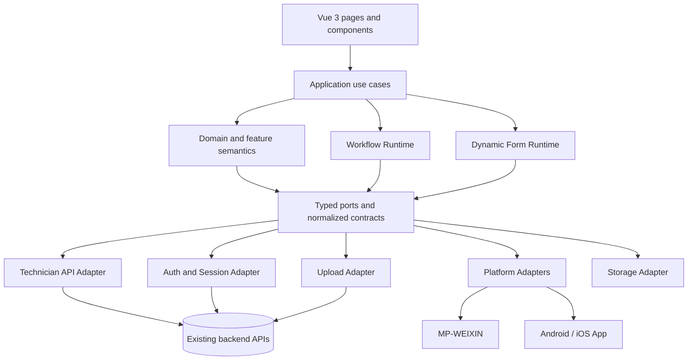

# Target Architecture

Status: G2 architecture decision record  
Program: New Technician / Field Service App  
Baseline: `9f95ce3dbebf8e559ab9538c7e3b8dd2585eaf11`  
Branch: `rebuild/g2-architecture-decision`

This document fixes the architecture boundary for G3. It is not application
code, a second Legacy scan, or a promise to preserve every historical widget
and branch. It consumes the accepted G1 evidence and turns it into an
implementation boundary for MP-WEIXIN, Android, and iOS.

## 1. Decision Summary

The new app will use one TypeScript business codebase built on Vue 3 and the
uni-app family. Shared business code will own user journeys, domain semantics,
Workflow Runtime, Dynamic Form Runtime, and normalized application state.
API/Auth, upload, storage, and device behavior will enter through explicit
ports implemented by adapters. MP-WEIXIN, Android, and iOS are equal first-
class targets; platform differences are isolated behind Platform Adapters.

The architecture is intentionally smaller than Legacy. It preserves observed
V1 behavior and backend wire compatibility where required, but it does not
preserve Legacy page structure, scattered literals, H5 parity, background
tracking, offline-first behavior, a generic low-code platform, or arbitrary
custom widgets.

G2 exit decision:

- shared MP/Android/iOS business architecture: FIXED
- layer dependency direction: FIXED
- API/Auth boundary: FIXED
- Workflow Runtime boundary: FIXED
- bounded Dynamic Form Runtime: FIXED
- Platform Adapter boundary: FIXED
- state management: FIXED
- native bridge policy: FIXED
- Legacy exception boundary: CONTROLLED
- G3 implementation entry: READY
- `BLOCKS_G3`: **0**

### Decision record: architecture direction

**DECISION** — Build one Vue 3 + uni-app + TypeScript application with
platform-neutral business modules and explicit adapters for MP-WEIXIN,
Android, and iOS.

**WHY** — G1 confirms that the primary variation is API, workflow/form
semantics, permissions, media, and native capability—not three independent
business products. One business model is the smallest surface that can keep
MP and App behavior aligned while allowing native differences where evidence
requires them.

**REJECTED / NOT CHOSEN** — Separate MP, Android, and iOS codebases; a
native-first rewrite; an H5-first architecture; copying Legacy pages into a
new shell; a framework reset without new evidence.

**CONSEQUENCE** — G3 must establish shared contracts and adapter ports before
implementing a vertical slice. Platform-specific code is permitted only in
the adapter boundary and must return normalized results.

## 2. Constraints Inherited from Program Control and G1

The following constraints are accepted inputs, not open architecture debates:

- The product journey is Login → Home → Work Order List → Work Order Detail →
  Customer Contact → Appointment → On-site Inspection → Inspection Form →
  Estimate / Quotation → Construction → Acceptance.
- V1 targets MP-WEIXIN, Android App, and iOS App.
- Existing backend APIs are reused. Backend redesign is not a prerequisite.
- Legacy repositories R1, R2, and R3 are reference-only and remain read-only.
- Reuse means behavior and contracts supported by evidence, not Legacy page
  architecture or unbounded hardcode.
- Unsupported dynamic capability must fail explicitly; it must not silently
  degrade to a different field, label, or successful empty value.
- V1 is not offline-first and has no accepted continuous/background tracking
  requirement.
- G1 closed PASS with `BLOCKS_G2 = 0`. G1 left later implementation and
  business-verification UNKNOWNs intentionally explicit.

Accepted evidence used for this decision:

| Evidence | Accepted content |
| --- | --- |
| `docs/discovery/API_CONTRACT_BASELINE.md` | Read contract, adapter, and deferred API semantics. |
| `docs/discovery/API_P0_READ_VERIFICATION.md` | P0 read verification and G2 readiness classification. |
| `docs/discovery/API_EVIDENCE_TRACEABILITY.md` | Evidence-to-contract traceability. |
| `docs/discovery/LEGACY_EXCEPTION_INVENTORY.md` | Legacy hardcodes, workarounds, domain rules, and drop candidates. |
| `docs/discovery/WORKFLOW_CAPABILITY_MATRIX.md` | Workflow identity, action, transition, and subworkflow boundary. |
| `docs/discovery/DYNAMIC_FORM_CAPABILITY_MATRIX.md` | Bounded field subset, option providers, visibility, and field-state rules. |
| `docs/discovery/PLATFORM_CAPABILITY_MATRIX.md` | MP/App capability, permission, media, and native boundary. |

G1 evidence was static and read-only. No architecture choice depends on a
new production call, a business mutation, or a reference-repository change.

## 3. Target Logical Architecture



The dependency direction is inward: UI depends on application contracts;
application and runtimes depend on domain types and ports; infrastructure
adapters implement ports. No inner layer imports a platform SDK, endpoint
path, storage key, native permission value, or Legacy component.

### Decision record: layered architecture

**DECISION** — Use four logical layers: Presentation, Application, Domain /
Runtime, and Infrastructure Adapters. Ports are owned by the inner layers and
implemented by infrastructure.

**WHY** — The G1 findings show independent variation in wire envelopes,
workflow identity, dynamic form interpretation, permissions, and media. A
layered port boundary prevents those concerns from becoming page-level
conditionals.

**REJECTED / NOT CHOSEN** — Page-to-endpoint calls; a shared utility folder
with no ownership; a Legacy-shaped component hierarchy treated as the domain
model; direct native calls from forms or workflow screens.

**CONSEQUENCE** — Every new cross-layer dependency must identify its owning
port and normalized type. A feature may not bypass an adapter because its
current platform call appears convenient.

## 4. Dependency Rules

1. Presentation imports view models, use-case commands, and normalized state.
   It does not import API DTOs, raw response envelopes, native objects, or
   Legacy constants.
2. Application services coordinate use cases and transaction boundaries. They
   do not render UI or encode MP/App branching.
3. Domain modules own stable business concepts such as work order, appointment,
   inspection, quotation, construction, and acceptance. Backend codes are
   represented by named types or registry entries at the adapter boundary.
4. Workflow Runtime owns workflow identity, visibility, action policy,
   transition intent, and refresh scope. Dynamic Form Runtime owns schema
   interpretation and field state. Neither is implemented as a page helper.
5. Ports define normalized inputs/outputs. API, Auth, Upload, Storage, and
   Platform Adapters own wire/platform translation.
6. A Platform Adapter may depend on a platform API; shared business code may
   not. Raw `wx`, `plus`, Android, or iOS objects stop at the adapter.
7. Compatibility literals require a typed registry entry with source evidence,
   owner, scope, and removal/review condition. A literal in a component is a
   design error unless it is presentation copy.
8. Server authorization is authoritative. Visibility of a button, field, or
   node is not authorization.
9. Read and write contracts are separate. A verified read shape does not
   authorize a guessed mutation envelope.
10. A feature may use another feature's public application contract, not its
    private store, component state, or adapter implementation.

## 5. Feature / Module Structure

The target structure is organized around the Technician journey and shared
runtime capabilities, not around Legacy pages:

```text
src/
  app/                 app bootstrap, routing, dependency wiring
  shared/
    types/             branded IDs, result/error types, common value objects
    config/             environment and compatibility registries
    state/              Pinia setup and cross-feature session state
    ui/                 presentation-only primitives
  adapters/
    api/               Technician API facade, DTO mappers, lookup adapters
    auth/              Auth Adapter and Session Adapter
    upload/            token, transport, and upload lifecycle
    platform/          MP/App implementations of platform ports
    storage/           semantic storage implementation
  runtimes/
    workflow/          Workflow Runtime
    dynamic-form/      bounded Dynamic Form Runtime
  features/
    auth/
    home/
    work-orders/
    customer-contact/
    appointment/
    inspection/
    quotation/
    construction/
    acceptance/
  test-support/        sanitized fixtures and contract test helpers
```

Each feature exposes use cases, view models, and route-level composition. A
feature can consume `workflow`, `dynamic-form`, `media`, and shared contracts;
it does not copy their implementation. The first G4 vertical slice will use
the smallest feature set needed to prove the architecture rather than
scaffolding every page.

### Decision record: feature boundaries

**DECISION** — Model modules by business capability and shared runtime, with
one public contract per module.

**WHY** — The target journey has stable business boundaries, while Legacy
pages mix API calls, workflow predicates, form rendering, and device behavior.
Capability modules make ownership reviewable and let G4 deliver slices.

**REJECTED / NOT CHOSEN** — One giant `pages` module; a one-to-one Legacy page
port; a generic `common.js` replacement; a microfrontend or multi-app split.

**CONSEQUENCE** — A new screen is composition of feature use cases and
runtime contracts. It is not permission to add another cross-cutting helper.

## 6. API / Auth Adapter Boundaries

### API Adapter

The API Adapter is the only owner of backend endpoint paths, request envelopes,
response envelopes, query conventions, backend code normalization, and wire
identifier encoding. It exposes normalized operations such as:

- `getHomeSummary`
- `listWorkOrders`
- `getWorkOrderDetail`
- `getWorkflowDefinition`
- `getWorkflowRun`
- `getWorkflowNode`
- `getFormDefinition`
- `getFormData`
- `getLookupOptions`
- named application commands whose write envelope is accepted by G4 evidence

These names are semantic ports, not a claim that every operation is already a
verified write contract. DTOs do not cross into feature screens. The adapter
keeps the current backend unchanged and records route variants and compatibility
exceptions in the registry.

### Auth and Session Adapter

The Auth boundary owns login, session restoration, current user and role
references, capability snapshot loading, expiry/invalid-session handling, and
logout. The Session Store contains only the minimum normalized session state:
session reference, user reference, current role reference, role version, and
safe capability metadata. Passwords and raw credentials are never persisted.

Session expiry, refresh, and logout wire details remain a G3 implementation
verification item. The boundary is not deferred: an expired or invalid session
must clear local identity, stop protected requests, and route to login. A
refresh attempt, if supported by the existing backend, is an Auth Adapter
policy rather than a page concern. UI capability visibility never substitutes
for server authorization.

### Decision record: API and Auth ownership

**DECISION** — Use one `TechnicianApi` semantic facade plus separate Auth and
Session ports. Normalize wire contracts before they reach runtimes or
features.

**WHY** — G1 found endpoint variants, lookup/code translation, opaque workflow
identities, form read exceptions, and session state spread through Legacy
pages. Central ownership preserves backend compatibility without importing
Legacy coupling.

**REJECTED / NOT CHOSEN** — Endpoint calls in components; a generic untyped
HTTP helper as the business API; a new backend/auth protocol; storing raw
tokens/passwords in feature state; deriving authorization from menu visibility.

**CONSEQUENCE** — G3 must implement ports and sanitized adapter fixtures
before a feature can depend on a backend response. The unresolved refresh and
logout semantics do not require a different application architecture.

## 7. Workflow Runtime Boundary

Workflow Runtime is a shared domain service. It is not a visual workflow
editor and not a collection of component `if` statements.

It owns:

- typed opaque identities:

  ```text
  WorkflowDefinitionId
  WorkflowRunId
  WorkflowNodeRuntimeId
  FormDefinitionId
  FormDataId
  SubworkflowRef { parentRunId, definitionId, runId }
  HandlerIdentity = User | Role | OrganizationRole
  ```

- node visibility based on declared metadata, state, and supported node type;
- handler identity normalization and action eligibility;
- named commands and preconditions for transitions, completion, rollback,
  takeback, cancellation, acceptance, quotation, and construction actions;
- parent/child workflow context and targeted refresh scope;
- status/code mapping through the compatibility registry;
- explicit blocked-action reasons and retry/idempotency state.

The API Adapter converts wire fields such as `defId`, `runId`, `workflowNodeId`,
`handlerIds`, and form identifiers. Screens never use an array index, display
label, or raw backend status as workflow identity. The source-index `1` rule,
fixed node IDs, service type `30`, status transitions, and handler composite
encoding are reviewed compatibility inputs, not general rules.

### Decision record: Workflow Runtime

**DECISION** — Fix a typed Workflow Runtime between features and the API
Adapter. It owns identity relationships, policies, commands, and refresh
scope; it does not own endpoint details or rendering.

**WHY** — G1-C found separate main/subworkflow identifiers, handler encodings,
status transitions, node-type actions, and Legacy array-position exceptions.
Those semantics require one owner even where exact write verification is later.

**REJECTED / NOT CHOSEN** — Passing raw workflow JSON to pages; using `runId`
or array position interchangeably; encoding transitions as button labels;
building a generic workflow designer; treating visible actions as permission.

**CONSEQUENCE** — G3 can define identity and policy interfaces without
claiming unresolved backend invariants. G4 verifies guarded transitions,
parent/child edge cases, and write envelopes against accepted fixtures.

## 8. Dynamic Form Runtime Boundary

Dynamic Form Runtime is a bounded schema interpreter for the Technician V1
subset. It is not a general-purpose low-code platform.

### Supported V1 generic subset

The runtime supports only the evidenced subset, subject to per-form selection
at G4:

`text`, `textarea`, `phone`, `IDNumber`, `number`, `digit`, `date`, `time`,
`datetime`, `select`, `bizSelect`, `cascade`, `radio`, `checkbox`, `switch`,
`rate`, `file`, `image`, and the named `area` measurement rule where its active
form scope is accepted.

Unsupported field types, unresolved option providers, and unselected custom
widgets produce an explicit capability error. They do not silently render as
text or submit an empty successful value.

### Option-provider resolution

The V1 order is deterministic:

1. `workType` resolves through the named `workTypes` provider.
2. A `cascade` field with `valueOption` resolves through
   `cascadeCode_<valueOption>`.
3. Other code-backed fields resolve through `codecfg_<valueOption>`.
4. Explicit inline options are used only when the schema declares ownership
   of those options.
5. If no provider is available, the field is unsupported or read-only for
   display according to the form policy; labels are never submitted as values.

The provider service completes option resolution before dependent visibility
is evaluated. Conflicting providers are a G3 contract error until an explicit
registry rule is accepted.

### Visibility and field-state precedence

The runtime applies this order:

1. Unsupported schema/widget or unresolved provider → explicit capability
   error.
2. Normalize field paths and evaluate visibility, including supported scalar,
   dotted, array, cascade, and `$exist` expressions.
3. Hidden fields are not interactively required and are omitted unless an
   explicit preservation policy requires their existing value.
4. Workflow/node state can force read-only. Completed, closed, non-handler,
   or policy-restricted state cannot be weakened.
5. A named, reviewed fixed-form override may add restriction or requirement;
   it never applies from a numeric ID without a registry entry.
6. Schema `readOnly` applies.
7. Runtime state may only add restriction, never weaken read-only.
8. Required validation runs only for visible, editable, effectively required
   fields. Existing read-only values may be preserved unchanged.

The API Adapter serializes normalized values into the current backend field
names and envelopes. The runtime owns validation and semantic values; it does
not know Qiniu, `wx` file objects, or component event shapes.

### Decision record: Dynamic Form Runtime

**DECISION** — Implement a bounded Dynamic Form Runtime with an explicit
field/widget registry, provider resolver, visibility evaluator, monotonic
read-only policy, validator, and serializer port.

**WHY** — G1-C proves repeated schema-driven behavior but also identifies
unsupported custom widgets, fixed-form exceptions, option-provider differences,
and incomplete Legacy precedence. A bounded runtime preserves reusable form
semantics without recreating a low-code product.

**REJECTED / NOT CHOSEN** — Porting all Legacy renderers; arbitrary custom
HTML/canvas/widget support; silently treating unknown types as text; applying
required/read-only rules in each page; using display labels as option values.

**CONSEQUENCE** — G3 can implement the runtime contract and explicit failure
states. G4 must select active form families and verify representative fixtures;
unsupported capability remains visible as a controlled product decision.

## 9. Platform Adapter Boundary

Shared business code sees semantic capability ports, never raw MP/App APIs.
The adapters cover:

| Port | Shared result | Platform-owned responsibility |
| --- | --- | --- |
| Storage | semantic key/value or scoped draft snapshot | MP/App persistence mechanics and retention |
| Location | one-shot `{ latitude, longitude, coordinateSystem, capturedAt }` | authorization, system service, settings, coordinate acquisition |
| Calendar | optional event result or non-blocking failure | MP/Android/iOS consent and event provider |
| Media capture | normalized local media item or cancelled/unavailable | camera permissions, capture route, native file shape |
| File/media picker | normalized media list or cancelled/unavailable | album/filesystem permissions and picker mechanics |
| Scan | `{ rawValue, format?, scannedAt }` or unsupported/cancelled | scanner implementation and camera capability |
| Phone contact | approved `DialContact` command result | dialer capability and platform gesture |
| Permission/capability | semantic state | native permission and settings APIs |

The shared capability states are:
`not_requested`, `granted`, `denied`, `denied_permanently_or_settings`,
`unavailable`, `unsupported_platform`, `cancelled`, and `error_retryable`.
Permission UX explains purpose and offers retry/settings/manual fallback where
the business flow allows it. A denied optional capability does not fabricate
success and does not automatically block unrelated workflow steps.

G1-D disposition is retained: session/storage, one-shot location, camera,
file/media selection, upload lifecycle, and the common permission model are
V1 boundaries; calendar, scan, customer dialer, and canvas are conditional or
unknown slice decisions; background tracking, clipboard shortcuts, H5 parity,
and unselected custom widgets are not V1 requirements.

### Decision record: Platform Adapters

**DECISION** — Use explicit semantic Platform Adapter ports with separate
implementations for MP-WEIXIN and App (Android/iOS), sharing the same business
contract.

**WHY** — G1-D shows genuine permission, system-service, media, and file-shape
differences. It also shows that the differences can be normalized at a clear
boundary without splitting business code.

**REJECTED / NOT CHOSEN** — `wx`/`plus` calls from feature components; treating
Android and iOS as separate business implementations; requesting all
permissions at login; adding H5 as a first-class V1 target; a generic plugin
framework for every historical widget.

**CONSEQUENCE** — G3 must provide capability ports and test doubles. G5 owns
real-device permission and native verification; unsupported capability states
are a supported result, not an implicit crash.

## 10. Media / Upload Boundary

Media has three distinct stages:

```text
capture or pick
  → normalized LocalMediaItem
  → Upload Adapter (token, transport, progress, retry)
  → UploadedMediaRef
  → API Adapter persists the reference in form/workflow data
```

The Platform Media Adapter owns local paths and native file objects. The
Upload Adapter owns token acquisition, transport, retry, and upload state.
The Dynamic Form Runtime owns field validation and whether required media is
complete. The API Adapter owns persistence of the resulting reference.
Qiniu endpoint details and upload tokens remain below the adapter boundary.
Required media cannot mark a form or workflow complete while it is pending or
failed. A retryable failure preserves safe local input without fabricating a
server reference.

### Decision record: media boundary

**DECISION** — Separate capture/picker, upload transport, and business
reference persistence into three ports.

**WHY** — G1 evidence shows platform-specific local file shapes, a token-based
upload flow, and separate form/workflow persistence. Combining them would
recreate Legacy coupling and make retry semantics unclear.

**REJECTED / NOT CHOSEN** — Uploading directly from form components; exposing
Qiniu/native response objects to the domain; treating a local file path as a
persisted URL; blocking all workflow behavior on optional media.

**CONSEQUENCE** — G3 can test media with local doubles and sanitized upload
fixtures. G4 verifies required-media persistence and retry behavior per slice.

## 11. State-Management Decision

Use Pinia as the application state container.

- Global stores: session/current user, current role, capability registry, and
  environment metadata only.
- Feature stores: work-order list/detail, appointment, inspection, quotation,
  construction, and acceptance state owned by their feature.
- Runtime state: Workflow Runtime owns workflow context; Dynamic Form Runtime
  owns active form state and effective field state.
- Server-derived data is cached per feature/use case with explicit loading,
  stale, retry, and invalidation behavior.
- Draft snapshots are scoped, expirable, user-local, subordinate to server
  data, and never an offline work-order database.
- No broad normalized entity graph, background synchronization queue, or
  hidden persistence is introduced in V1.

### Decision record: state

**DECISION** — Pinia with small global stores, feature-local stores, and
runtime-owned form/workflow state.

**WHY** — The app needs predictable shared session/capability state and
feature-local server data, but G1 provides no requirement for offline entity
sync or a global normalized graph.

**REJECTED / NOT CHOSEN** — Global mutable singleton objects; a giant store
containing every screen; Redux-style ceremony without a requirement; an
offline database and sync engine; storing form state in arbitrary components.

**CONSEQUENCE** — Store ownership is reviewable. A later offline requirement
would be a program-level architecture change, not an accidental feature.

## 12. Network / Error Model

All API, Auth, upload, and platform operations expose explicit state:

`idle → loading → succeeded`  
`loading → failed_retryable`  
`loading → failed_terminal`

Errors are classified into:

- `session_invalid`: clear protected identity and require login;
- `authorization_denied`: show a blocked action, never retry blindly;
- `validation`: return field/domain errors without losing safe input;
- `unsupported_capability`: explain the bounded-runtime/platform limitation;
- `network_retryable`: preserve local safe state and offer retry;
- `server_terminal`: show an actionable failure and preserve evidence;
- `cancelled`: normal user/platform outcome, not a system error.

No operation reports success until its required server persistence is known.
There is no offline success, eventual-sync promise, background retry queue, or
silent fallback to stale identity in V1.

### Decision record: failure semantics

**DECISION** — Use typed operation state and typed error categories across
network, auth, upload, form, workflow, and platform ports.

**WHY** — G1-D explicitly requires retryable media/network failures and
semantic capability states. A common model prevents each screen from inventing
different recovery behavior.

**REJECTED / NOT CHOSEN** — Toast-only failures; boolean `loading` flags;
silent empty responses; offline-first optimistic success; treating permission
denial as a network error.

**CONSEQUENCE** — UI can provide consistent retry, settings, login, and
manual-fallback actions. Tests can assert failure state without a real device.

## 13. Configuration / Compatibility Registry

All retained Legacy exceptions are represented by typed registry entries, not
scattered constants. An entry includes:

```text
name
semantic purpose
scope (form/workflow/tenant/platform)
wire value(s), if any
source evidence and accepted commit
owner gate
confidence
activation condition
safe fallback
review/removal condition
```

Registry examples include workflow node references, handler wire encoding,
status transitions, active form read exceptions, `workType` providers,
service-type acceptance behavior, and the declarative survey-area rule. A
fixed numeric ID alone never activates behavior. Tenant/customer/role literals
remain configuration inputs requiring current ownership evidence and are not
copied into application code.

The registry is a compatibility boundary, not a place to hide arbitrary page
logic. Every entry must be referenced by a named runtime or adapter policy.

### Decision record: compatibility registry

**DECISION** — Centralize accepted wire and business exceptions in typed,
scoped registries with provenance and owner gates.

**WHY** — G1-B/C/D found fixed IDs, code mappings, status predicates,
platform exceptions, and Legacy workarounds. Centralization preserves only
what is evidenced and makes later removal possible.

**REJECTED / NOT CHOSEN** — Copying literals into templates; a catch-all
`legacyMode`; tenant-specific branches without ownership; keeping every
historical branch “just in case.”

**CONSEQUENCE** — Exceptions are visible in review and test fixtures. An
unknown entry is blocked or read-only by default rather than silently active.

## 14. Native Bridge Policy

Use the uni-app/common platform capability first. Add a thin native bridge only
when a required V1 capability cannot be expressed through the shared uni-app
surface and the capability has an accepted owner, platform contract, and test
plan.

Native bridges must:

- expose one semantic TypeScript port to shared code;
- be capability-specific, not a general scripting or plugin host;
- normalize permission, cancellation, unavailable, and error states;
- contain no workflow/form/business policy;
- have MP, Android, and iOS parity or an explicit unsupported result;
- be introduced only after a G3/G4 slice proves the need.

No new native bridge is required to start G3. Calendar, App scan, customer
dialer, canvas/signature, and other conditional capabilities remain behind
ports until their slice requirement is accepted.

### Decision record: native bridge

**DECISION** — Prefer common uni-app APIs; allow only thin, capability-scoped
native bridges behind Platform Adapter ports.

**WHY** — G1-D identifies native differences but does not justify a broad
native framework or new plugin class. A thin bridge protects the shared model
while keeping native risk proportional to accepted product need.

**REJECTED / NOT CHOSEN** — Native-first business logic; direct SDK imports
throughout the app; a generic plugin/low-code bridge; implementing every
historical MP-only helper before a V1 slice exists.

**CONSEQUENCE** — G3 can proceed with test doubles and common APIs. G5 is the
gate for device-specific bridge verification and any approved additions.

## 15. Testing / Verification Strategy

Testing follows the same boundaries as production code:

1. Pure domain tests for named value objects, status mappings, action policy,
   capability state, and error classification.
2. Workflow Runtime tests for typed identity joins, visibility, handler
   normalization, command preconditions, parent/child refresh, and explicit
   unknown/blocked states.
3. Dynamic Form Runtime tests for provider precedence, visibility expressions,
   required/read-only precedence, supported widgets, validation, serialization,
   and unsupported capability errors.
4. Adapter contract tests using sanitized fixtures derived from accepted G1
   evidence. Fixtures must not contain production credentials, tenant secrets,
   customer data, or unverified write assumptions.
5. Feature/component tests for loading, retry, blocked action, empty, and
   success states, including safe draft recovery where selected.
6. Platform verification on MP-WEIXIN, Android, and iOS for permissions,
   location, camera/media, upload, and selected conditional capabilities.
7. Guarded backend write verification only after the relevant G4 contract and
   safety scope are accepted; no guessed mutation tests in G3.
8. G6 side-by-side verification against Legacy for business outcomes and
   supported V1 semantics, not DOM/page parity.

### Decision record: verification

**DECISION** — Test pure runtimes and adapters independently, then verify
selected vertical slices on all three target platforms and side-by-side at G6.

**WHY** — The risk is contract and boundary drift, not just rendering. Static
evidence supports sanitized fixtures and deterministic runtime tests before
real device verification.

**REJECTED / NOT CHOSEN** — Snapshotting Legacy pages as the architecture
oracle; testing only MP; testing only happy-path UI; production calls as a
substitute for fixtures; broad native builds during G2.

**CONSEQUENCE** — G3 can establish a test harness without application
features. G4/G5/G6 own progressively stronger contract and platform evidence.

## 16. Environment / Configuration Strategy

Build targets are explicit: `dev`, `test`, `staging`, and `prod`, with
platform-specific build selection for MP-WEIXIN, Android, and iOS. Each
environment supplies an API base URL and non-secret feature/configuration
values through the build/runtime configuration layer. Secrets, signing
material, credentials, and production tokens remain outside the repository and
are injected by the delivery environment.

Environment configuration is separate from the compatibility registry:

- environment config answers “where/how does this build connect?”;
- compatibility config answers “which accepted backend/business exception is
  active, why, and who owns it?”

Production defaults are never used by local tests. Sensitive values are not
logged, committed, reproduced in fixtures, or placed in issue comments.

### Decision record: environment

**DECISION** — Use typed, build-target-specific environment configuration with
secrets injected externally, separate from reviewed compatibility entries.

**WHY** — G1 contains tenant/configuration UNKNOWNs that must not become
source-level branches. Separating deployment configuration from semantics
keeps the architecture portable and auditable.

**REJECTED / NOT CHOSEN** — Hardcoded endpoints or credentials; a single
production-like `.env`; tenant names in components; runtime mutation of
architecture rules from arbitrary remote JSON.

**CONSEQUENCE** — G3 must define config validation and safe defaults. G4/G6
verify environment routing and active business configuration before any gray
release.

## 17. Explicit Non-Goals

The following are intentionally not part of the G2 architecture or V1:

- H5 parity or an H5-first delivery target;
- offline-first work-order storage, synchronization, conflict resolution, or
  eventual-success semantics;
- background/continuous technician location tracking;
- a generic low-code or arbitrary custom-widget platform;
- automatic parity for every Legacy field type, canvas action, menu, or branch;
- separate business codebases for MP, Android, and iOS;
- backend redesign, endpoint migration, or replacement of existing APIs;
- copying Legacy page hierarchy, hardcoded tenant/customer/role branches, or
  obsolete menu paths;
- a new native plugin framework or native business logic;
- analytics, notification, or unrelated product-surface migration;
- treating UI labels, array positions, or button visibility as contracts.

An item in this list requires a reviewed program change and an explicit gate;
it cannot enter through an implementation shortcut.

## 18. Deferred Architecture UNKNOWNs and Owner Gates

The following are deferred architecture UNKNOWNs. They do not prevent G3
because the relevant ownership boundary and failure behavior are fixed. They
must remain visible in implementation plans and test gates.

| ID | Deferred UNKNOWN | Why architecture is still safe | Owner gate |
| --- | --- | --- | --- |
| AU-01 | Exact session expiry, refresh, and logout wire semantics. | Auth/Session Adapter owns all variants; invalid session has one safe behavior. | G3 Auth Adapter contract; G4 guarded verification |
| AU-02 | Exact work-order tab/count parity and refresh semantics. | Work-order feature consumes a normalized list-summary port; semantics do not alter layers. | G4 Work Order List slice |
| AU-03 | Active V1 form/workflow registry entries and tenant/customer/role branches. | Compatibility Registry defaults inactive and requires provenance; no branch is copied blindly. | G3 config contract; G4 business-owner verification |
| AU-04 | Parent/child `runId` uniqueness, stale-node behavior, and completion propagation. | Workflow Runtime already separates opaque identities and refresh scope. | G3 identity contract; G4 workflow fixtures |
| AU-05 | Exact conflicting option-provider resolution in historical schemas. | Provider resolution is centralized and unsupported conflicts fail explicitly. | G3 Dynamic Form Runtime contract |
| AU-06 | Full Legacy required/read-only precedence across all forms and nodes. | Runtime precedence is monotonic and explicit; representative forms can verify it. | G3 runtime tests; G4 form fixtures |
| AU-07 | Exact write envelopes, idempotency, and destructive-command response shapes. | Write ports are separate from verified reads and can be guarded by the API Adapter. | G4 workflow/form write verification |
| AU-08 | Calendar mandatory/optional policy and duplicate/update event semantics. | Calendar is an optional Platform Adapter command and never blocks core workflow. | G4 Appointment slice |
| AU-09 | App parity and V1 necessity for scan, dialer, canvas/signature, and other custom actions. | Each is a conditional port with explicit unsupported behavior; no generic bridge is required. | G4 slice selection; G5 device verification |
| AU-10 | Final environment endpoint provenance and active deployment partition. | Environment config is external and typed; semantic code is not tenant-bound. | G3 config validation; G6 environment/business verification |

Deferred architecture UNKNOWN count: **10**.  
True `BLOCKS_G3` count: **0**.

These UNKNOWNs are intentionally not resolved by another broad Legacy scan.
Each has a later owner gate and a minimum verification scope. If a future
probe changes a foundational boundary, it must reopen G2 through Program
Control rather than silently changing this document.

## 19. G3 Implementation Entry Plan

G3 may start from this branch after review. Its ordered entry plan is:

1. Scaffold the Vue 3 / uni-app / TypeScript workspace and build-target
   configuration without adding business pages.
2. Establish the layer/module rules, path aliases, lint/type/test boundaries,
   and dependency injection for ports and adapters.
3. Define branded IDs, normalized result/error types, operation state, and the
   typed compatibility/environment registries.
4. Implement Auth/Session, API, Storage, Upload, and Platform port contracts
   with test doubles; verify no raw platform objects cross the boundary.
5. Implement the Workflow Runtime identity/policy contracts and bounded
   Dynamic Form Runtime contracts with pure tests.
6. Add Pinia stores only for approved global and feature-local state.
7. Add sanitized adapter fixtures and contract tests for accepted read paths.
8. Select the first G4 vertical slice only after the foundation tests pass;
   do not rediscover Legacy broadly or infer unverified write envelopes.

G3 exit requires the foundation to demonstrate shared business code on MP,
Android, and iOS build targets, even if conditional native capabilities are
reported as explicit unsupported states until G5. G3 does not close any
deferred business UNKNOWN; it proves that the architecture contains them
safely.

### G2 completion criteria

This record satisfies the G2 decision scope when reviewed together with the
accepted G1 documents:

- one shared MP/Android/iOS business architecture is explicit;
- dependencies and adapter ownership are explicit;
- Workflow Runtime and bounded Dynamic Form Runtime are fixed;
- Platform Adapter and media/upload boundaries are fixed;
- state choice, native bridge policy, error model, and configuration policy
  are explicit;
- Legacy exception handling is controlled through provenance and owner gates;
- non-goals are explicit;
- ten deferred architecture UNKNOWNs are named with owners;
- `BLOCKS_G3 = 0`;
- G3 can begin without broad Legacy rediscovery.
