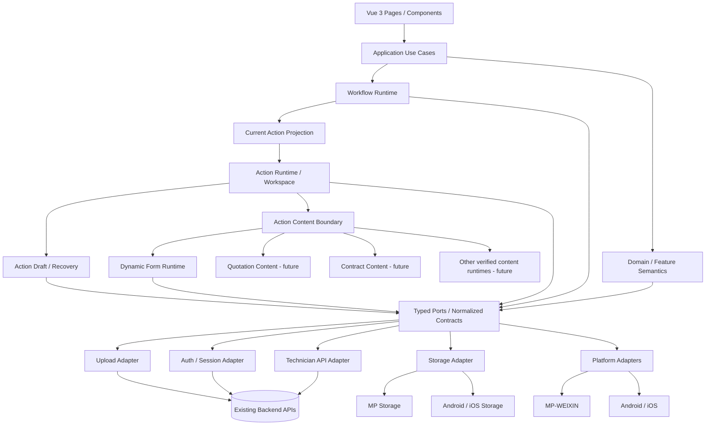

# Target Architecture — Living Architecture Record

> **Mainline context update (2026-10-30):** The G2/G4-D architecture invariants below remain the long-term decision authority. The original `Working branch`, `Implementation baseline reviewed`, and older descriptions of Quotation/Contract as `future` are **historical stage metadata**, not the implementation status of today's main. Read the [main implementation snapshot](IMPLEMENTATION_BASELINE_20261030.md), [documentation index](../README.md), and [mainline policy](../../AGENTS.md) before using those passages for work planning. This notice changes no approved business or API semantics.

Status: Living target architecture  
Program: New Technician / Field Service App  
Original architecture decision: G2  
Current revision: G4-D / Action Workspace architecture review  
Implementation baseline reviewed: `2ab3190e1d480612001786fbd29d5e56b6771ee2`  
Working branch: `rebuild/g4d-action-workspace`

This document is the current high-level architecture authority for the new Technician App.

The original G2 architecture direction remains valid unless explicitly revised below. The purpose of this revision is not to replace that architecture, but to incorporate what G3, G4-UX, and G4-D have proven in implementation and to make the frontend execution model explicit before later workflow slices such as Inspection, Quotation, Contract, Construction, and Acceptance.

Architecture is treated as a living program artifact. Material implementation evidence may refine this document, but foundational changes require explicit architecture review rather than silent drift inside a feature branch.

Related focused architecture:

- `docs/architecture/ACTION_WORKSPACE_ARCHITECTURE.md` — detailed Action Driven / Action Workspace frontend execution architecture.
- `docs/architecture/AI_ENGINEERING_LOOP.md` — engineering/AI collaboration loop.

---

## 1. Current Architecture Decision Summary

The application uses one shared Vue 3 + uni-app + TypeScript business codebase for:

- MP-WEIXIN;
- Android App;
- iOS App.

All three are first-class product targets.

The core dependency direction remains:

```text
Presentation
  -> Application
  -> Domain / Runtime
  -> Typed Ports
  -> Infrastructure Adapters
```

The frontend runtime architecture has evolved from the original G2 model of:

```text
Workflow Runtime
Dynamic Form Runtime
```

into the more explicit execution model:

```text
Workflow Runtime
  -> Current Action Projection
  -> Action Runtime / Action Workspace
  -> Action Content Runtime
       -> Dynamic Form Runtime
       -> Quotation Content     (future)
       -> Contract Content      (future)
       -> Media / Signature     (future)
       -> Composite Content     (future)
```

This is an architectural refinement, not a reversal of G2.

### Current fixed decisions

- one shared TypeScript business codebase for MP / Android / iOS: **FIXED**;
- Vue 3 + uni-app family: **FIXED**;
- inward layered dependency direction: **FIXED**;
- API/Auth/Storage/Upload/Platform adapter boundaries: **FIXED**;
- Workflow Runtime as workflow identity/eligibility authority: **FIXED**;
- Action Runtime / Action Workspace as shared business-action execution boundary: **FIXED AS TARGET**;
- Dynamic Form Runtime as a bounded Action Content runtime, not the whole action architecture: **FIXED**;
- Work Order Detail as business context + current action + read-oriented information: **FIXED**;
- Mock / Real semantic-path equivalence: **FIXED**;
- local draft persistence separated from business submission: **FIXED**;
- V1 is not offline-first and has no generic queued business-mutation engine: **FIXED**;
- platform differences stop at typed adapters/ports: **FIXED**;
- Legacy business truth is reused without copying Legacy architecture: **FIXED**.

---

## 2. Business Truth and Reference Authority

The project now uses an explicit authority model.

### R1 / real backend

`xlink-business-jishi-3.0` and verified current backend behavior are authoritative for:

- current production business sequence;
- role/permission semantics;
- workflow semantics;
- status/business-state semantics;
- API behavior;
- mutation behavior;
- validation and required business outcomes;
- operational edge cases.

R1 is business truth, not implementation architecture truth.

### R2

`xlink-business-3.0` is a UX / IA / interaction reference only where useful.

R2 logic is incomplete and must not be used to invent:

- backend contracts;
- workflow transitions;
- business status mappings;
- permissions;
- missing production business rules.

### New App

The new App is a modern implementation of verified current business behavior.

The permanent audit question is:

> Is this behavior a required current business capability, or merely a historical Legacy implementation choice?

The App preserves required outcomes and wire compatibility where necessary while redesigning state management, architecture, interaction structure, runtime ownership, and error handling using current engineering principles.

---

## 3. Current Logical Architecture



No inner layer imports:

- raw endpoint paths;
- backend DTO/envelope shapes;
- raw storage keys;
- `wx`, `plus`, Android, or iOS SDK objects;
- Legacy components or page helpers.

---

## 4. Layer and Dependency Rules

1. **Presentation** consumes view models, application commands, Runtime projections, and normalized state. It does not consume backend DTOs or authorize business actions from labels.
2. **Application** coordinates use cases, invalidation, reread, and transaction boundaries. It does not render UI or encode platform branching.
3. **Domain / Runtime** owns semantic identities, policies, execution state, and business-safe abstractions.
4. **Typed Ports** define semantic inputs/outputs owned by inner layers.
5. **Adapters** own backend wire details, session wire behavior, storage mechanics, native SDK interaction, and compatibility translation.
6. Features may consume another feature/runtime public contract, not its private store or implementation internals.
7. Backend literals and compatibility exceptions must remain adapter/config-owned and evidence-backed.
8. Server authorization is authoritative; visible UI is never an authorization source.
9. Read evidence does not authorize guessed write contracts.
10. Unknown or unsupported semantics fail conservatively rather than being inferred from labels, indexes, colors, or menu position.
11. Mock and Real must resolve through the same semantic runtime path.
12. Business execution must remain separate from read-oriented information surfaces.

---

## 5. Frontend Execution Architecture

The Technician App is **Action Driven**.

The core product relationship is:

```text
Work Order Detail = business context
Workflow Runtime  = what is currently allowed / required
Current Action    = what the technician should do now
Action Workspace  = where the technician performs the task
Action Content    = business-specific editor/component
```

### 5.1 Work Order Detail

Work Order Detail owns:

- order/customer/service context;
- read-oriented information;
- Current Action presentation;
- navigation into an Action Workspace.

It does not own:

- complex action-editor state;
- local draft persistence;
- business mutation orchestration;
- workflow transition guessing.

Information tabs remain read-oriented.

A business action is not embedded as a dynamic information tab.

### 5.2 Workflow Runtime — revised responsibility

Workflow Runtime remains the authority for:

- workflow identity;
- node lifecycle;
- action visibility;
- actor/role/handler eligibility;
- semantic action identity / intent;
- execution authorization;
- conservative unknown/blocked behavior.

Workflow Runtime does **not** become a general action editor or page lifecycle manager.

It should not own:

- draft persistence;
- action autosave;
- action-form UI state;
- quotation editor state;
- contract editor state;
- platform-specific execution mechanics.

UI must not infer action eligibility from:

- Chinese labels;
- status labels;
- button copy;
- color/tone;
- menu position;
- node array index.

### 5.3 Current Action Projection

Current Action is the normalized bridge between workflow semantics and user execution.

It expresses only evidence-backed information such as:

- semantic action intent;
- runtime-node identity;
- presentation label/context;
- whether execution is enabled or read-only/blocked;
- content identity required to open a workspace.

This projection prevents Vue pages from recreating workflow rules.

### 5.4 Action Runtime / Action Workspace

Action Runtime is the shared cross-action execution boundary.

It owns or coordinates:

- semantic action identity;
- execution lifecycle;
- workspace readiness;
- draft identity;
- local autosave;
- restore eligibility;
- stale-action protection;
- submission lifecycle;
- retryable/terminal failure semantics;
- success semantics;
- authoritative reread after successful mutation.

Action Workspace is the standard UI execution shell for main business actions.

Default interaction:

```text
Work Order Detail
  -> Current Action CTA
  -> Full-page Action Workspace
  -> edit / autosave / leave / resume
  -> submit
  -> explicit success/failure
  -> authoritative backend/workflow reread
  -> return to Detail
  -> Workflow Runtime derives next action
```

Full-page execution is the default because action complexity is not stable. A later action may contain a short form, long inspection form, quotation editor, contract/signature component, media capture, or composite business editor.

Dialogs and bottom sheets remain appropriate for short auxiliary confirmation, not as the universal business-action container.

### 5.5 Action Content Boundary

The Action Workspace must not assume all actions are forms.

Conceptual content kinds include:

```text
dynamic_form
quotation
contract
media_signature
composite
```

Only content kinds with verified implementation are executable.

Unknown content kinds fail explicitly or remain unavailable.

No empty future module should be created merely because a future content kind is named here.

### 5.6 Dynamic Form Runtime

Dynamic Form Runtime remains a bounded schema interpreter.

It owns:

- supported field types;
- option-provider resolution;
- visibility;
- required/read-only precedence;
- field normalization;
- validation;
- semantic submission values.

It is an **Action Content Runtime**, not the top-level business-action architecture.

Appointment is the first Action Workspace consumer and uses Dynamic Form Runtime as its content engine.

---

## 6. Feature / Module Direction

The codebase is organized by business capability and shared runtime ownership rather than Legacy pages.

Target responsibility map:

```text
src/
  app/
    bootstrap / routing / dependency wiring

  shared/
    types/
    config/
    state/
    ui/
    ports/

  adapters/
    api/
    auth/
    storage/
    upload/
    platform/

  runtimes/
    workflow/
    action/
    dynamic-form/

  features/
    auth/
    home/
    work-orders/
    customer-contact/
    appointment/
    inspection/        # only when active
    quotation/         # only when active
    contract/          # only when active
    construction/      # only when active
    acceptance/        # only when active

  pages/
    ... route-level composition only
```

This is a responsibility map, not permission to scaffold inactive future modules.

---

## 7. State Management

Pinia remains the application state container.

### Global state

Keep global state small:

- authenticated session/current user;
- current role;
- safe capability/environment metadata.

### Feature state

Feature stores own server-derived data and use-case state for their feature.

Examples:

- Work Order List;
- Work Order Detail;
- Appointment;
- later active slices.

### Runtime state

Runtime-owned state is separate from page state:

- Workflow Runtime owns workflow/action eligibility semantics;
- Action Runtime owns action execution/draft lifecycle;
- Dynamic Form Runtime owns effective form/field semantics.

### No giant global entity graph

V1 does not introduce:

- a global normalized business database;
- hidden offline synchronization;
- background mutation queues;
- one giant store containing all screens.

---

## 8. Action Draft and Weak-Network Architecture

Local draft persistence is now a first-class frontend architecture capability.

It is deliberately narrower than offline-first.

### 8.1 Draft identity

A draft is scoped to stable semantic action identity, conceptually:

```text
ActionDraftKey =
  Session/User scope
  + WorkOrderId
  + WorkflowNodeRuntimeId
  + Action semantic kind
  + Content identity/version when needed
```

A draft must never leak:

- between users/sessions;
- between work orders;
- between workflow nodes;
- between incompatible content/schema versions.

### 8.2 Draft storage

Action Content does not call platform storage directly.

Draft persistence flows through a typed storage boundary and Storage Adapter.

A draft contains semantic recoverable editor state only; it must not persist credentials, raw API envelopes, or transport state.

### 8.3 Autosave

Editable actions use debounced local autosave.

Typical flow:

```text
edit
  -> dirty
  -> debounce
  -> local persistence
  -> saved_local
```

Autosave should avoid writing on every keystroke while still protecting field-service work from ordinary interruption.

### 8.4 Restore and stale protection

Opening an Action Workspace should:

1. read current authoritative action/workflow state;
2. resolve current semantic Action Identity;
3. inspect a local draft for that exact identity;
4. restore only if compatible;
5. isolate/clear stale drafts conservatively.

A draft from an old workflow node must not be applied to a newly activated node merely because both share the same visible title.

### 8.5 Weak-network rule

The permanent distinction is:

```text
Local draft saved != Business action succeeded
```

No network may still allow local editing/autosave where the content permits it.

But a backend workflow/form/quotation/contract mutation must not be reported as successful unless the required business persistence is known.

V1 does not automatically queue `workflow/process` or other business writes for later replay.

Queued offline mutation requires a separate program-level decision because it introduces ordering, idempotency, stale workflow, and conflict semantics.

---

## 9. Mock / Real Equivalence

Mock / Real equivalence is now a high-level architecture invariant.

```text
Mock raw business-shaped data
  -> Adapter
  -> Runtime
  -> Feature / Action Workspace
  -> UI

Real backend raw data
  -> same Adapter contracts
  -> same Runtime
  -> same Feature / Action Workspace
  -> same UI
```

Mock is not a second product and not UI placeholder data.

Mock values may be synthetic, but the following must remain production-faithful where evidence exists:

- semantic field structure;
- nullability;
- relationships;
- workflow identity shape;
- lifecycle/operation behavior;
- validation behavior;
- failure behavior.

There must be no Mock-only Vue business semantics.

The local simulator should expose deterministic development scenarios sufficient to test current functionality and UX, including where applicable:

- fresh state;
- partially completed draft;
- restored draft;
- validation failure;
- retryable failure;
- terminal failure;
- successful mutation;
- post-success authoritative reread.

Synthetic identifiers must never fall through to a Real transport path.

---

## 10. API / Command / Auth Boundary

### API Adapter

The API Adapter is the only owner of:

- endpoint paths;
- HTTP/wire method details;
- body/query conventions;
- raw response envelopes;
- backend code/status translation;
- backend identifiers that are not semantic domain identities.

Features and runtimes consume semantic typed ports.

### Read / write separation

Verified reads do not imply verified writes.

Write operations require separate evidence and semantic commands.

The App must not infer successful workflow/business outcome from a local UI state change. Successful mutation is followed by invalidation and authoritative reread when the resulting state is backend-owned.

### Command response normalization

Backend transport/business-envelope semantics are normalized at the adapter boundary, including session-invalid and business-failure responses.

Raw backend messages or wire sentinels do not become page-level control flow.

### Auth / session

Auth and Session boundaries own:

- login;
- session restore;
- current identity/role;
- invalid-session handling;
- logout;
- future refresh behavior if the backend supports it.

Protected operations stop when session identity is invalid.

The UI never derives authorization merely from capability visibility.

---

## 11. Network / Operation / Error Model

Networked and platform operations use explicit normalized state rather than boolean loading flags.

Existing shared operation states remain authoritative where applicable:

```text
idle
loading
succeeded
failed_retryable
failed_terminal
```

Action Runtime may expose richer action lifecycle states, but it must map cleanly to the shared operation/error taxonomy rather than creating a competing error system.

Error categories include:

- `session_invalid`;
- `authorization_denied`;
- `validation`;
- `unsupported_capability`;
- `network_retryable`;
- `server_terminal`;
- `cancelled`.

No operation reports business success until required persistence is known.

Toast-only failure handling is insufficient as an architecture model.

---

## 12. Platform Adapter Boundary

Shared business code sees semantic capability ports, never raw platform APIs.

Platform adapters normalize differences for:

- Storage;
- Location;
- Camera/media capture;
- File/media picker;
- Phone/dialer;
- Calendar when required;
- Scan when required;
- Signature/canvas when required;
- other explicitly approved native capabilities.

Raw `wx`, `plus`, Android, or iOS objects stop at the adapter boundary.

The preferred implementation order remains:

1. standard uni-app/shared capability;
2. thin platform-specific adapter;
3. thin native bridge only when required by an accepted business capability.

No generic plugin/native framework is introduced pre-emptively.

MP-WEIXIN, Android, and iOS must either share semantic parity or return an explicit unsupported result.

---

## 13. Media / Upload Boundary

Media remains split into three responsibilities:

```text
Platform capture/pick
  -> normalized local media
  -> Upload Adapter
  -> uploaded media reference
  -> API / business persistence
```

The Platform Adapter owns local/native file shape.

The Upload Adapter owns:

- token acquisition;
- upload transport;
- progress;
- retry;
- upload result.

Dynamic Form or other Action Content runtimes own whether media is required and semantically complete.

A local path is never treated as an already persisted backend media reference.

---

## 14. Configuration and Compatibility Registry

Environment configuration and compatibility/business exceptions remain separate.

### Environment configuration

Answers:

> Where and how does this build connect?

Examples:

- `dev`;
- `test`;
- `staging`;
- `prod`;
- API base URL;
- safe feature/build flags.

Secrets/signing material/credentials remain outside the repository.

### Compatibility registry

Answers:

> Which evidence-backed backend/business exception exists, why, in what scope, and under what owner gate?

Compatibility entries require:

- semantic purpose;
- scope;
- wire value where necessary;
- source evidence;
- confidence;
- activation rule;
- safe fallback;
- review/removal condition.

A raw numeric ID alone must not become presentation/business logic.

---

## 15. Native Bridge Policy

Use common uni-app capability first.

A native bridge is allowed only when a required verified business capability cannot be expressed adequately through the shared platform layer.

A bridge must:

- expose one semantic TypeScript port;
- remain capability-specific;
- normalize cancellation/permission/unavailable/error states;
- contain no workflow/business policy;
- avoid leaking native objects upward;
- have explicit MP/Android/iOS behavior or supported `unsupported_platform` semantics.

Native-first business logic and broad plugin hosts remain rejected.

---

## 16. Testing and Verification Strategy

Tests follow architecture boundaries.

1. **Domain/runtime tests** — semantic policies, identities, lifecycle and error classification.
2. **Workflow Runtime tests** — visibility, role/handler eligibility, action projection, unknown/blocked behavior.
3. **Action Runtime tests** — draft identity, autosave, restore, stale protection, failure preservation, success reread.
4. **Dynamic Form Runtime tests** — field capability, option providers, visibility, required/read-only, validation, normalization.
5. **Adapter contract tests** — sanitized backend-shaped fixtures and exact wire mapping where accepted.
6. **Feature/component tests** — loading, empty, retry, blocked, draft, interruption, and success states.
7. **Mock / Real parity tests** — both transports resolve through the same semantic boundaries.
8. **Platform verification** — MP-WEIXIN + Android + iOS for selected native capability behavior.
9. **Guarded backend write verification** — only after explicit contract/safety authorization.
10. **G6 side-by-side verification** — compare required business outcomes with R1, not DOM/page parity.

Production calls are not a substitute for deterministic fixtures/tests.

---

## 17. Explicit Non-Goals

The following remain outside current V1 architecture unless explicitly reopened:

- H5 parity as a first-class target;
- offline-first work-order database;
- general offline business-mutation queue;
- background/continuous location tracking;
- generic low-code platform;
- arbitrary Legacy widget parity;
- separate MP/Android/iOS business codebases;
- backend redesign as a prerequisite;
- copying Legacy page/component architecture;
- treating UI labels, menu positions, array positions, or colors as contracts;
- pre-building quotation/contract/inspection implementations before their slices are active;
- generic native/plugin host.

---

## 18. Evolution of the Original G2 Deferred UNKNOWNs

The original G2 document recorded ten deferred architecture unknowns. G3/G4 implementation has resolved or narrowed several of them. They are now tracked by status instead of a static G2 count.

| ID | Original concern | Current status | Current owner / next evidence |
| --- | --- | --- | --- |
| AU-01 | Session expiry, refresh, logout wire semantics | **PARTIALLY RESOLVED** — invalid-session behavior and observed restart semantics are normalized; complete refresh/logout variants remain backend-evidence dependent | Auth / later integration verification |
| AU-02 | Work-order list/count/tab/refresh semantics | **PARTIALLY RESOLVED** — list/detail read and invalidation patterns implemented; full Legacy parity is not an architecture requirement | active Work Order slices / G6 |
| AU-03 | Active form/workflow/tenant/role registry entries | **PARTIALLY RESOLVED** — evidence-backed active entries exist; future slices add only verified entries | each G4 slice |
| AU-04 | Parent/child workflow identity, stale-node propagation | **DEFERRED** where not required by current slice; typed runtime boundary remains safe | future workflow slices |
| AU-05 | Historical conflicting option-provider cases | **DEFERRED / BOUNDED** — unsupported conflicts fail explicitly | future representative forms |
| AU-06 | Required/read-only precedence across all Legacy forms | **PARTIALLY RESOLVED** — Dynamic Form Runtime precedence established; remaining forms verified per slice | future form slices |
| AU-07 | Write envelopes, idempotency, destructive-command shapes | **PARTIALLY RESOLVED** — Accept Order and Appointment verified/implemented behind semantic commands; other mutations remain evidence-gated | each write-capable slice |
| AU-08 | Calendar policy / duplicate-update semantics | **DEFERRED** — not required for G4-D V1 | future explicit calendar requirement |
| AU-09 | App necessity/parity for scan, dialer, canvas/signature | **PARTIALLY RESOLVED** — direct phone path exists; other native capabilities remain slice-driven | G4/G5 |
| AU-10 | Final environment endpoint provenance/deployment partition | **DEFERRED** without architectural risk due typed environment boundary | G6 / release |

### New architecture questions introduced by Action Workspace

These are not blockers for introducing the pattern but must remain explicit:

| ID | Question | Safe current rule | Owner |
| --- | --- | --- | --- |
| AU-11 | Draft retention/expiry and explicit user cleanup policy | scope strictly by session/user + action identity; fail conservatively; no cross-action reuse | Action Runtime implementation / UX |
| AU-12 | Local draft vs server-edited conflict semantics | no automatic merge; restore only exact compatible action identity; later conflict policy requires evidence | future multi-device/conflict need |
| AU-13 | Future Quotation/Contract/Composite content contracts | Action Content boundary exists; do not scaffold or infer business semantics early | corresponding future G4 slices |

An unresolved item is not permission to infer behavior. It remains blocked, unsupported, or conservatively under-displayed until evidence exists.

---

## 19. Architecture Invariants

These are standing review gates for current and future slices.

1. R1 / verified backend behavior is business truth; R2 is UX/IA reference only.
2. Presentation does not own endpoint/wire/storage/platform mechanics.
3. Workflow Runtime decides action identity/visibility/eligibility.
4. Vue does not authorize an action from labels/status/index/menu position.
5. Work Order Detail is context + Current Action + read-oriented information.
6. Main business execution occurs in an Action Workspace, normally a full page.
7. Action Runtime owns shared execution/draft/recovery semantics.
8. Action Content is pluggable; not every action is a form.
9. Dynamic Form Runtime is a bounded content engine, not the entire action system.
10. Draft identity is stable, scoped, versionable, and isolated by user/session/work-order/action.
11. Local draft success never implies backend business success.
12. V1 does not queue offline workflow mutations automatically.
13. Successful backend mutation is followed by authoritative reread when backend owns resulting state.
14. Mock and Real use the same Adapter/Runtime/Feature/UI path.
15. Synthetic IDs never fall through to Real backend transport.
16. Platform-specific APIs stop at adapters/ports.
17. Unsupported capabilities fail explicitly rather than silently degrading.
18. Write contracts remain separately evidence-gated from read contracts.
19. Future functionality does not justify copying Legacy architecture.
20. Foundational boundary changes require architecture review and document update.

---

## 20. Architecture Review Cadence

This document is intentionally living rather than frozen at G2.

Architecture review should occur when one of the following happens:

- a new shared Runtime is introduced;
- a feature repeatedly needs to bypass an existing layer;
- cross-platform constraints force a new abstraction;
- local/offline/draft semantics materially expand;
- a new Action Content class such as Quotation or Contract requires a reusable execution model;
- backend evidence invalidates an existing semantic boundary;
- a feature proposes general infrastructure to solve a one-off problem;
- several completed vertical slices reveal recurring architecture drift.

Routine feature/UI iteration does not require rewriting this document.

Recommended process:

```text
Vertical Slice Evidence
  -> Architecture Review if material
  -> update TARGET_ARCHITECTURE
  -> focused architecture doc where necessary
  -> implement / verify
```

The goal is to keep the high-level architecture synchronized with proven engineering reality without turning it into a changelog of every implementation detail.

---

## 21. Current Architecture Execution Priority

The current architecture priority is to implement the Action Workspace pattern defined in:

`docs/architecture/ACTION_WORKSPACE_ARCHITECTURE.md`

using Appointment as the first consumer.

That implementation should establish only the reusable execution foundation needed now:

- Current Action -> dedicated Action Workspace navigation;
- Action Runtime execution lifecycle;
- typed action identity;
- local draft/autosave/restore;
- weak-network local-save semantics;
- Dynamic Form as the Appointment Action Content;
- Mock/Real parity;
- authoritative reread after success.

Detailed Appointment visual/interaction design is a separate Product Owner UX/UI step after the execution foundation exists.

Do not use the Action Workspace architecture as permission to start G4-E, Quotation, Contract, Construction, or other later business slices prematurely.

