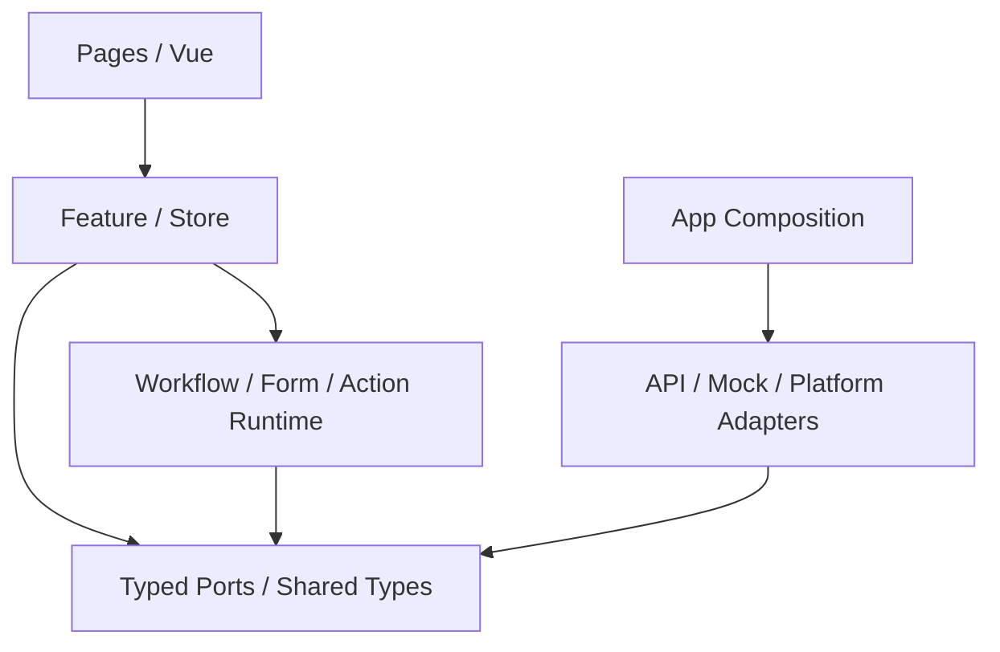

# M1 — Module Dependency, Ownership & Duplication Audit

> **Status:** M1 engineering evidence candidate; no business code or public API
> changes. **Source baseline:** `main@a8f0ee7d728d3d8273486baa7fb00a5586f7b51b`
> (2026-10-31, after C6/C7). This is a *static import graph*, not a runtime
> call graph, UI acceptance or evidence authorizing Production/Beta writes.
>
> Authority: [Target Architecture](../architecture/TARGET_ARCHITECTURE.md),
> [Code Organization](CODE_ORGANIZATION_STANDARD.md),
> [C3/C4/G3 Closure](C3_C4_G3_ARCHITECTURE_CLOSURE_20261030.md).
> Historical [G0C inventory](../governance/G0C_SOURCE_DEPENDENCY_SNAPSHOT_20261030.json)
> remains frozen to `17ba721` and is not silently replaced.

## 1. Exact-main evidence

The audited repository has a common Vue 3 / uni-app / TypeScript business
codebase for MP-WEIXIN, Android and iOS. We parsed TypeScript source files and
Vue `<script>` imports, exports and static literal `import()` calls;
resolved aliases and relative targets and separated type-only from runtime
edges. The output is deterministic and checked against a reviewed no-growth
baseline. Template-level auto registration, non-literal dynamic imports and
bundle tree-shaking are **outside this scanner's scope**.

| Metric | M1 baseline | Interpretation |
| --- | ---: | --- |
| TS/Vue modules | **286** | Existing source modules, not all assets |
| Unique local import/export edges | **1,005** | 724 runtime + 281 type-only |
| **Runtime strongly connected components** | **0** | No static runtime import cycle found |
| All-static SCCs (including types) | **3** | Type-only mutual references exist |
| Direct dependency-policy exceptions | **2** | Known exact edges, ratcheted |
| Unresolved local TS/Vue imports | **0** | All recognized internal imports resolve |
| Cross-owner edges | **676** | Descriptive only; most are legal and expected |
| Identical domain export-name collisions | **0** | Not proof that no duplicated business rule exists |

Reproducible evidence:

- [Full module graph](../governance/M1_SOURCE_DEPENDENCY_GRAPH_20261031.json)
  — **286 nodes / 1,005 explicitly typed edges**, with module owner labels.
- [Protected dependency baseline](../governance/M1_SOURCE_DEPENDENCY_BASELINE_20261031.json)
  — exact exception signatures and baseline counts.
- `pnpm audit:modules` — read-only summary and risk candidates.
- `pnpm check:module-dependencies` — CI no-growth ratchet with injected
  negative controls (new SCCs, new cross-layer edges, unresolved imports).

## 2. Main dependency direction

This is the **approved dependency model**, not a literal rendering of every
import. M1's full recorded graph is linked above. `App Composition` is the
intentional integration boundary; inner business code must not import adapter
implementations or decide real-vs-Mock policy itself.

The most frequently imported modules are `src/shared/ports/index.ts`
(115 source consumers) and `src/shared/types/index.ts` (96). These are
intentionally public type/contract surfaces: their high fan-in is **not**
by itself a defect. The largest outgoing source dependency counts are
`pages/work-orders/action-workspace.vue` (38),
`pages/work-orders/detail.vue` (30), and
`features/work-orders/action-workspace.ts` (28). They are review entry
points, not authorized refactor targets merely because they are large.

## 3. Confirmed exception edges — no business rewrite in M1

| Risk | Actual static edge | Evidence-based recommendation |
| --- | --- | --- |
| **P1 / runtime cross-feature private reference** | `features/home/draft-diagnostics.ts` → `features/work-orders/action-workspace.ts` | In M2, review whether `actionWorkspaceRouteFor` should be exposed via a stable Work Order public contract instead of Home reaching into a private feature file. Preserve exact route behavior. |
| **P2 / type-only dependency inversion** | `features/work-orders/components/MockJourneyContextPanel.vue` → `app/mock-journey-context.ts` | A DEV Mock display-only type reaches into the Composition/App layer. Consider a neutral type contract only after verifying its consumers; no runtime dependency or release boundary failure is evidenced. |

The three all-static SCCs contain **type-only** links, and none is a runtime SCC:

1. `adapters/api/action-command-wires.ts` ↔
   `adapters/api/technician-api-commands.ts`;
2. `adapters/api/r1-node-form-list.ts`,
   `adapters/api/read-models/work-order.ts`,
   `adapters/api/read-models/workflow.ts`,
   `adapters/api/technician-api.ts`;
3. `features/work-orders/action-workspace-read-model.ts` ↔
   `features/work-orders/action-workspace.ts`.

Type-only cycles are not evidence of a circular runtime initialization bug.
M2 should consider moving shared type contracts to stable neutral owners if
it can remove an SCC without fragmenting domain ownership. The M1 gate
rejects **new** SCCs and newly unapproved dependency exceptions; it does not
break existing code just to achieve an artificial all-static zero.

## 4. Duplicate business implementation: evidence, not guesswork

M1 found **no exported domain function with an identical name implemented
across distinct owner groups**. This limited exact-name check is **not**
proof of semantic uniqueness: two different functions can implement the
same business rule under different names, and presentation conversion can
legitimately differ from backend normalization.

| Business rule | Existing designated authority | M2 follow-up only if equivalence tests show overlap |
| --- | --- | --- |
| Workflow eligibility and identity | `runtimes/workflow/` + Work Order projection | Compare display-only fallback with executable eligibility; never infer permissions from labels. |
| Form metadata and visibility | `features/work-orders/action-form-schema.ts` + `runtimes/dynamic-form/` | Compare schema interpretation vs UI formatting; avoid creating an extra Form rules engine. |
| Quotation price and Order type=1 | `features/work-orders/quotation/engine.ts`, `pricing.ts`, `order-encoder.ts` | Search for alternative totals/encoding outside the engine using behavioral fixtures, not matching names. |
| Business command wire | `adapters/api/action-command-wires.ts` and `technician-api-commands.ts` | Preserve existing separate save-only, complete, reject and readback semantics. |
| R1 read normalization | `adapters/api/read-models/` behind `technician-api.ts` | C4 already extracted pure mapping; do not repeat that refactor. |
| Mock/Real protocol | Shared Typed Ports + distinct real/mock adapters | Compare success, rejection, identity and ambiguous receipt cases; **do not** unify Mock and real transport. |

The candidate priority for M2 is **P1: confirmed Home-to-WorkOrder private
reference**, then **P1: quotation UI/store responsibility review with
behavioral equivalence tests**. Type-only SCC cleanup and DEV Mock type
placement are lower priority. No production-compatible state transition,
API contract, approved UI/CSS or Golden should change as part of M1.

## 5. Gate semantics and current closure

- New runtime *or type-only* SCC **member-group signatures** are blocked against
  the reviewed snapshot. Edges added inside an already approved SCC group are
  not independently rejected by this rule; existing groups may shrink or
  disappear freely.
- New cross-layer/cross-feature private edge signatures are blocked; removing
  existing exceptions is welcome.
- A recognized new unresolved TS/Vue local import is blocked.
- Ordinary growth of legal module/Port dependencies is **not** blocked, nor
  are page/view sizes or shared UI fan-in treated as quality violations.
- `--refresh-baseline` / `--write-graph` are **explicit review operations**:
  do not silently rebaseline new violations to make CI green.
- Existing `check:boundaries` and `check:engineering-ownership` remain
  mandatory. This M1 guard supplements them; it does not replace them.

## 6. Verification ledger (isolated M1 worktree)

| Gate | Result | Evidence |
| --- | --- | --- |
| `pnpm check:module-dependencies` | **PASS** | Injected runtime and type-only cycles, three boundary violations and a missing import were rejected; removal remains allowed |
| `CI=true VITE_XLINK_ENVIRONMENT=test pnpm verify:full` | **PASS** | Existing comprehensive source/ownership/quality, TypeScript and 170-suite test gates |
| `CI=true pnpm build:h5` | **PASS** | H5 production compilation; four DEV QA routes excluded |
| `CI=true pnpm build:mp-weixin` | **PASS** | MP compiler, release QA, bootstrap and emitted WXSS guard |
| `CI=true pnpm build:app` | **PASS** | App compiler, release source/config guards |
| Exact-head GitHub PR CI | **PENDING** | Must be checked on the review PR before Owner approval |

The `CI=true` prefix uses uni-app's built-in version-check bypass. In this
restricted local container, running its default online version check without
`CI=true` causes Node's `os.networkInterfaces()` to fail; that is an
environment-only build invocation issue, not a change to production code.
No Production/Beta requests or business mutations are part of M1.
